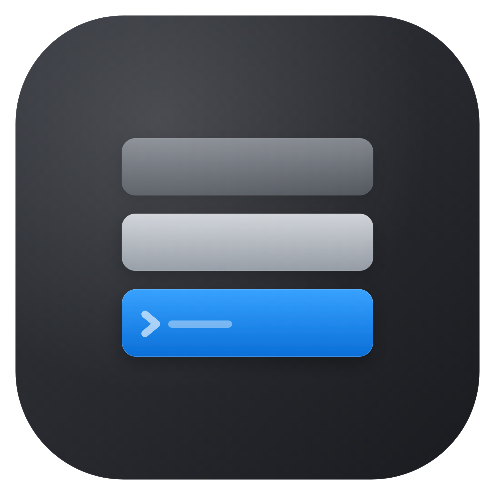
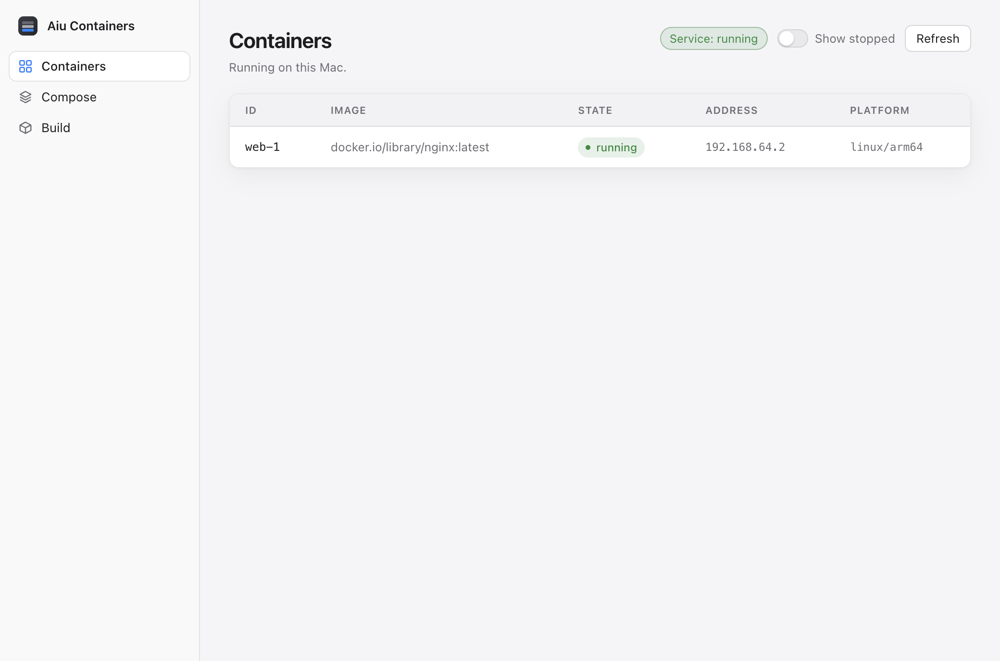
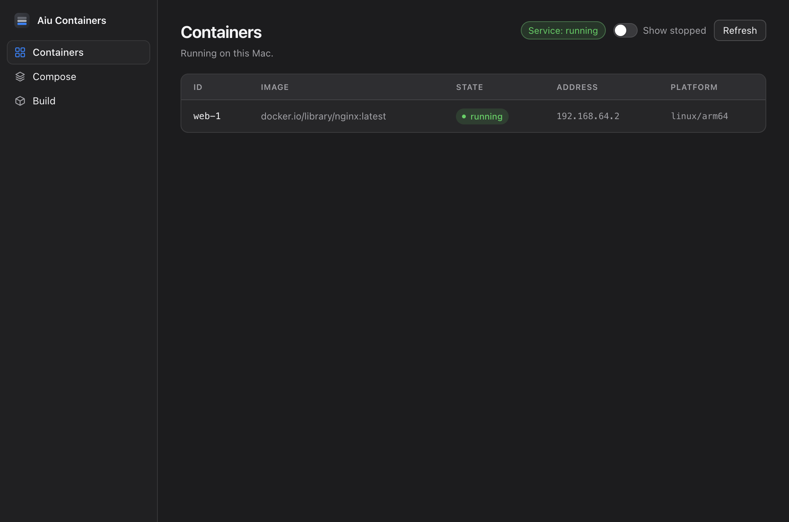
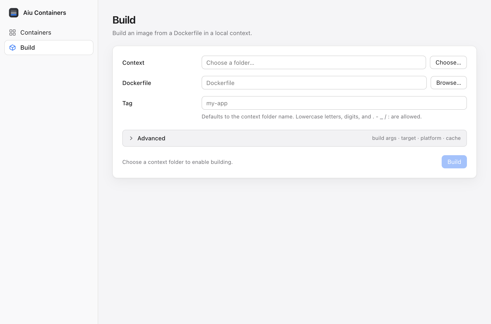
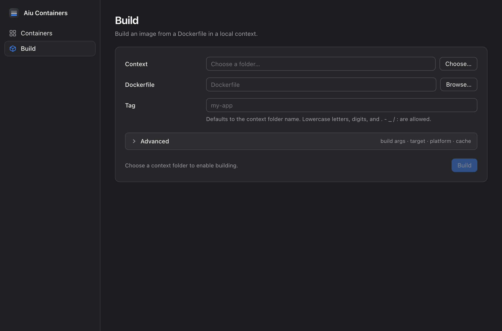
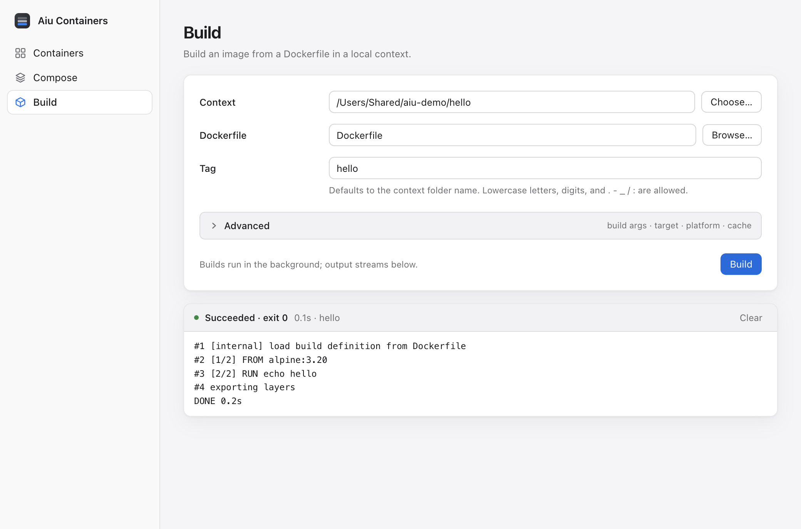

<p align="center">
  
</p>

<h1 align="center">Aiu Containers Electron</h1>

<p align="center">
  A small macOS app for Apple's <a href="https://github.com/apple/container"><code>container</code></a> runtime:
  see what is running and build images from a Dockerfile, with live output.
</p>

<p align="center">
  <a href="https://github.com/ionutale/aiu-containers-electron/actions/workflows/ci.yml"></a>
  
  
  
  
</p>

---

## Screenshots

| Containers — light | Containers — dark |
| --- | --- |
|  |  |

| Build — light | Build — dark |
| --- | --- |
|  |  |

**Streamed build output**



<sub>Screenshots are captured from the real app by `node scripts/screenshots.mjs`, using the deterministic fake runtime and a demo context; the GitHub-rendered PNGs are 2× (Retina). A `containers-narrow.png` capture is also committed to check the collapsed sidebar at 820px.</sub>

## What it does

**Containers**

- Lists **running** containers by default (`container list --format json`); a **Show stopped** toggle includes stopped ones (`--all`).
- Auto-refreshes every 3 seconds while the window is visible, plus a manual **Refresh**.
- Shows the container service state; if it is down, a banner offers **Start service**.
- Clear states for a missing `container` CLI and for malformed CLI output (with the raw excerpt).
- State chips, monospace IDs/addresses, and an empty state that tells you what to do next.

**Build**

- **Context** folder picker, Dockerfile auto-detection (`Dockerfile` → `Containerfile`) and a tag that defaults to the folder name.
- **Advanced**: build args (`KEY=VALUE` per line), target stage, platform, and **No cache**.
- Live, streamed build output with stderr highlighted, auto-scroll that pauses when you scroll up, **Cancel**, and a result footer (`Succeeded` / `Failed` / `Canceled`, exit code, elapsed time, tag).
- Backend validation (missing context, bad tag, malformed build args) is reported in the form before anything runs.

Everything runs through Apple's own CLI in the Electron **main process**; the renderer only talks to it through a typed, sandboxed IPC bridge (`window.containers`).

## Requirements

- macOS on Apple silicon (arm64).
- Apple `container` CLI **0.10+**, installed and working:

  ```bash
  container --version        # container CLI version 0.10.0
  container system start     # start the container service
  container system status    # should report status: running
  ```

  The app looks for `container` on `PATH`, then falls back to `/usr/local/bin/container` and
  `/opt/homebrew/bin/container`. Set `CONTAINER_BIN` to point at a specific binary.

- Node.js **26+** and [pnpm](https://pnpm.io/) **12** (pinned via `packageManager`) for development.

## Install and run

```bash
git clone https://github.com/ionutale/aiu-containers-electron.git
cd aiu-containers-electron
```

```bash
pnpm install   # postinstall also verifies the Electron binary (see Troubleshooting)
pnpm dev       # run in development
```

## Build and package

```bash
pnpm build      # type-check and compile into out/
pnpm build:mac  # compile and package an unsigned dmg into dist/
```

`pnpm build:mac` produces `dist/aiu-containers-electron-<version>.dmg` and an unpacked
`dist/mac-arm64/Aiu Containers Electron.app`.

### First launch (Gatekeeper)

The dmg is **unsigned**. On first launch macOS refuses to open it
(_"… cannot be opened because the developer cannot be verified"_).
Open it once via **right-click (or Control-click) → Open → Open**. Later launches work normally;
if it is still blocked, use **System Settings → Privacy & Security → Open Anyway**.

## Architecture

```
src/
  main/
    index.ts                 window lifecycle, IPC wiring, dialogs
    ipc.ts                   typed ipcMain handlers (injected deps)
    context.ts               Dockerfile / Containerfile discovery
    container-cli/
      cli.ts                 binary discovery, run/stream, cancel, version
      parsers.ts             tolerant JSON parsers (real v0.10.0 shapes)
      commands.ts            list / status / start with classified errors
      build.ts               validation, argv, single-build BuildManager
  preload/index.ts           contextBridge → window.containers (sandboxed)
  shared/                    types, IPC channels, error classification
  renderer/                  Svelte 5 UI (Containers, Build)
tests/                       Vitest: unit, integration (fake CLI), components
e2e/                         Playwright Electron end-to-end specs
scripts/                     icon pipeline, screenshots, Electron self-repair
```

- **One process owns the CLI.** `child_process` calls live only in `main/container-cli/`; argv arrays
  are never shell strings.
- **Streaming over IPC.** Build stdout/stderr arrive as line-buffered events (`build:output`) and a
  completion event (`build:done`); a single `BuildManager` enforces one build at a time and
  SIGTERM→SIGKILL cancellation.
- **Tolerant by design.** Parsers never throw on missing fields and were validated against JSON
  captured from the real CLI; malformed output surfaces as a classified error, not a crash.
- **Security defaults.** `contextIsolation: true`, `nodeIntegration: false`, `sandbox: true`; the
  preload exposes a small typed API and nothing else.

## Testing

```bash
pnpm test       # Vitest: parsers, argv, errors, IPC wiring, CLI/commands/build integration, Svelte components
pnpm test:e2e   # builds, then drives the real Electron app with Playwright
pnpm lint
pnpm typecheck  # main/preload + tests/e2e/scripts + Svelte renderer
```

- **Integration tests** spawn a stateful fake `container` CLI (`tests/fake-container/container`) on
  `PATH`, mirroring the real v0.10.0 JSON shapes, service-down/XPC errors, malformed output, and
  build modes (success, failure, blocking for cancellation).
- **E2E** launches the built app with the fake CLI and covers the container list, toggle, badge,
  auto-refresh, empty/CLI-missing/service-down/parse-error states, the full build form, streamed
  success, failure, and cancellation with proof the process is gone.
- `pnpm test:e2e:real` runs one smoke test against your machine's real runtime (service must be
  running); it is skipped unless `AIU_E2E_REAL_CLI=1`.

### Automation overrides

| Variable | Effect |
| --- | --- |
| `CONTAINER_BIN` | Use this `container` executable instead of searching `PATH`. A non-executable path surfaces as the CLI-missing state. |
| `AIU_E2E_DIR_DIALOG` | The context-folder picker returns this path instead of opening a native dialog (unpackaged builds only). |
| `AIU_E2E_FILE_DIALOG` | The Dockerfile picker returns this path instead of opening a native dialog (unpackaged builds only). |

## Troubleshooting

**The app won't start and says "Electron uninstall" / "Electron failed to install correctly"**

Electron's install step can stall: its `extract-zip` postinstall sometimes exits successfully after
extracting a single file. `pnpm install` repairs this automatically — the `postinstall` hook runs
`scripts/ensure-electron-dist.mjs`, which detects the broken state and re-extracts the cached zip
with macOS `ditto`. Re-run the check any time:

```bash
pnpm doctor
```

If it reports that no cached zip was found, run `pnpm rebuild electron`, or extract manually:

```bash
cd node_modules/.pnpm/electron@*/node_modules/electron
rm -rf dist && mkdir dist
ditto -xk ~/Library/Caches/electron/*/electron-v*-darwin-arm64.zip dist
printf 'Electron.app/Contents/MacOS/Electron' > path.txt
```

This is an environment issue with Electron's install step, not something the app does.

**The Containers screen says the service is not running**

Start it with `container system start` (or use **Start service** in the banner).

**The Containers screen says the `container` CLI was not found**

Install the Apple `container` CLI and make sure `container` is on `PATH` (or at
`/usr/local/bin/container` / `/opt/homebrew/bin/container`, or set `CONTAINER_BIN`).

**The first build is slow**

The first build pulls the builder image; progress is visible in the streamed log. Later builds are
much faster — use **No cache** to force a full rebuild.

## Notes and non-goals

- The app lists containers, builds images, and can start the service. Creating/running containers,
  logs/stats/exec, and image/network/volume/registry management are done with the CLI and are not
  part of this app.
- The dmg is unsigned and not notarised; there is no auto-update, tray, or Windows/Linux build.
- A lighter-weight companion to the full-featured Qt app `aiu-containers`.

## License

[MIT](LICENSE) © Ion Utale
